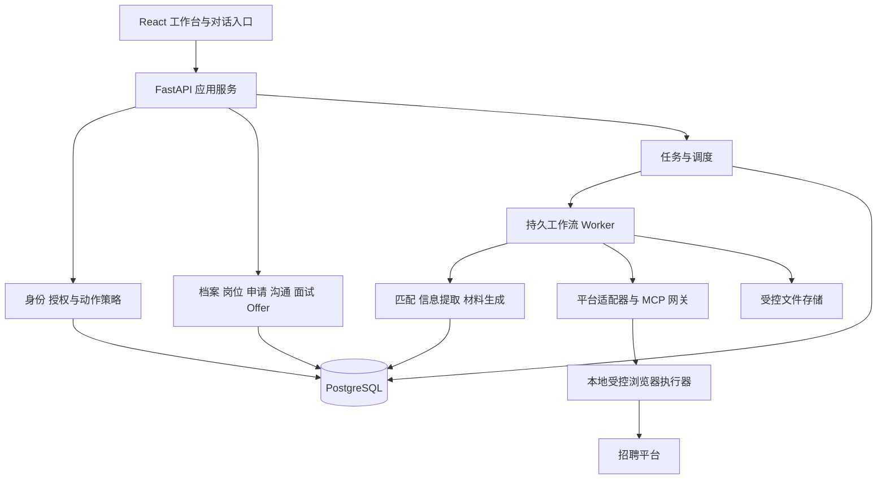

# 产品与系统架构

## 1. 用户与目标

Job-Bot 服务正在求职的个人，帮助其维护真实经历、发现岗位、比较匹配程度、准备针对性材料、协助申请、跟进沟通与面试、比较 Offer 并复盘。关键痛点是信息分散、重复填写、岗位选择缺少依据、材料版本混乱及跟进遗漏。

一次成功的完整任务是：用户确认档案和偏好，系统获取或导入岗位，解释排序，准备可核对材料，经用户授权执行申请或记录人工申请，保存结果，并将后续沟通、面试和结果绑定到同一申请。即使外部平台暂时不可用，用户已有数据与业务流程仍可访问。

不承诺获得面试或录用；不根据姓名、性别等与岗位能力无关的属性排序。年龄、婚育等不进入个人匹配特征。用户可自定通勤、薪资和工作方式偏好。

## 2. 完整功能需求

| ID | 功能与输入 | 系统行为与输出 | 必须满足的边界 |
|---|---|---|---|
| F01 | 档案建立：PDF、DOCX、纯文本与手动输入 | 提取教育、经历、技能、时间线；展示原文定位与候选事实；用户逐项确认 | 扫描件可进入 OCR；解析错误能修正；推测不得直接进入确认底稿 |
| F02 | 求职策略：目标岗位、地点、薪资、到岗时间 | 保存多个命名策略，拆分硬条件与软偏好；产生可编辑搜索计划 | 未知条件与不满足分开；不默认开启对外发送 |
| F03 | 岗位发现：平台搜索、链接、粘贴文本、文件导入 | 标准化岗位、保存快照、去重、标记采集与发布时间 | 平台能力和数据来源可见；导入不能触发任意地址访问 |
| F04 | 岗位筛选与匹配：档案版本、策略版本、岗位集合 | 过滤、排序、证据解释、缺口与未知项；收藏/拒绝及原因 | 基于确认底稿；生成简历不提高原始能力评分 |
| F05 | 材料定制：选定岗位、经历素材 | 要求与证据映射、重点追问、简历草稿、纯文本版、沟通草稿 | 不编造事实；可比较版本；不同岗位版本隔离 |
| F06 | 申请执行：目标账户、岗位、已确认材料 | 预览、审批、执行、核实、记录外部证据 | 防重；不确定结果冻结；明确区分打招呼、发送简历和提交申请 |
| F07 | 沟通跟进：平台消息或用户导入 | 去重入库、关联申请、提取待办、生成待审回复、提醒 | 不支持读取时展示手动模式；不会自动答应薪资或面试安排 |
| F08 | 面试管理：邀请、时间、轮次、面试方式 | 时区确认、日程冲突提示、岗位资料包、基于投递材料的追问、复盘 | 时间含糊必须澄清；改期取消更新原事件；不自动对外承诺 |
| F09 | Offer 管理：条款、期限、偏好 | 存储原文与结构化条款、可调权重比较、待澄清清单 | 未知奖金不当确定收入；币种/周期不一致不直接相加；接受或拒绝由用户决定 |
| F10 | 结果与反馈：申请阶段、拒绝原因、反馈 | 阶段漏斗、时间分布、策略表现、下一轮建议 | 按实际可观察数据计算；未回复不直接标为拒绝；小样本不声称因果改善 |
| F11 | 任务与通知：手动/定时触发 | 进度、暂停/取消/恢复、预算限制、站内通知 | 重启不丢进度；用户等待不占用 Worker；休眠期间不保证准时运行 |
| F12 | 数据管理：导出、删除、备份与连接设置 | 用户数据包、删除任务、连接诊断、恢复 | 日志脱敏；会话与密钥不进普通导出；删除覆盖派生向量与文件 |
| F13 | 对话任务入口：自然语言需求、已选对象、附件引用 | 澄清意图、提出可编辑计划、调用允许的能力、展示结构化结果与进度 | 对话不能直接授权模型外发；计划和任务可恢复，事实与页面操作使用同一服务 |
| F14 | 排除与重复沟通规则：企业、岗位、联系人、拒绝原因 | 用户管理排除名单、选择是否查看被排除结果；每次发送检查历史 | 不从一次拒绝自动永久屏蔽整个公司；再沟通必须显示历史并新授权 |

## 3. 用户流程

### 3.1 首次使用

选择模型提供方与本地数据目录 → 导入简历 → 核对提取结果 → 确认事实 → 建立求职策略 → 选择岗位导入或连接平台 → 运行搜索/匹配。尚未配置模型时仍可管理档案、导入岗位、使用基础关键词匹配，模型依赖按钮说明原因。

解析失败保留原文件与错误；不能从失败文件制造空的已确认档案。对同一文件重复导入按内容摘要提示已有记录。

### 3.2 搜索与申请

用户确认搜索条件 → 搜索任务生成岗位快照 → 匹配任务引用固定档案/策略版本 → 用户选择岗位 → 生成材料并补充事实 → 审阅版本 → 创建动作预览 → 授权 → Worker 检查授权和前置条件 → 执行 → 保存证据 → 更新申请。

若授权后 JD、材料、收件目标或账户发生变化，动作过期并要求重新预览。若登录失效，等待用户登录；若平台限制或验证出现，暂停平台任务，不通过更换身份或绕过验证继续。

某平台的“打招呼成功”只证明消息动作成功，不自动证明简历已提交。申请阶段只有达到该适配器声明的申请完成条件或用户明确回填后才更新。

### 3.3 沟通到结案

新消息进入时间线 → 区分招聘方提问、面试邀请和普通消息 → 用户核对待办/回复 → 按需要创建发送动作 → 面试记录绑定申请与材料快照 → 面试后填写结果 → Offer 条款比较 → 用户记录接受、拒绝、撤回或关闭。

同一申请可有多轮面试与多条 Offer 修订；历史不覆盖。阶段更正记录旧值、新值、原因与操作者。

### 3.4 定时运行

用户设置策略、频率和运行上限；调度器创建搜索任务，结果去重后通知。默认仅定时读取与分析。批量发送只能针对逐项确定的动作列表授权，不能将“帮我找工作”解释为无限发送许可。电脑休眠后恢复只补一次最新搜索，避免集中重放过期任务。

### 3.5 对话式任务

用户消息进入 ChatSession；编排器解析为受限意图：建立/修改策略、搜索、匹配、准备材料、查询进度、整理沟通、面试准备或Offer比较。目标不明确先追问；明确的读取分析可直接创建任务，涉及事实确认、策略改变或外部动作则呈现对应表单/确认卡。

计划为有限步骤列表，每步含能力名、对象引用、依赖、完成条件、预算和是否等待用户。先校验对象归属与工具白名单，再运行。默认每计划最多20步、同一失败步骤最多2次自动恢复；超过预算转waiting_user。模型无法在计划中填写任意函数名或执行脚本。

页面卡片与对话摘要引用同一任务与实体，不复制独立状态。用户说“改成北京”时产生新策略版本及新搜索任务；正在执行的旧任务可取消，已发生的外部动作不能被新对话回滚。长对话只检索必要版本化业务事实；聊天摘要不能覆盖事实底稿。

## 4. 页面规格

| 页面 | 主要内容 | 操作 | 加载、空态、错误与恢复 |
|---|---|---|---|
| 今日工作台 | 待确认动作、未知结果、待回复、面试、任务摘要 | 进入处理、暂停任务 | 空态引导导入；断线展示最后更新时间；unknown 优先提示核实 |
| 档案 | 经历列表、原文引用、候选/确认状态、版本 | 编辑、确认、撤销确认、新建版本 | 解析进度与逐文件错误；旧事实变更列出受影响材料 |
| 求职策略 | 硬条件、偏好、搜索词、计划与预算 | 保存版本、启停定时搜索 | 冲突条件阻止启动；无匹配建议放宽指定条件而非悄悄放宽 |
| 岗位中心 | 来源、职位、公司、地点、薪资单位、抓取时间、匹配依据 | 筛选、刷新、收藏、拒绝、准备申请 | 区分无结果、加载失败和平台不支持；分页保留过滤条件 |
| 岗位详情 | 原文、快照日期、条件、证据映射、缺口、历史 | 查看证据、补充事实、申请 | 过期/下架显著提示；旧快照仍可查看但不直接执行提交 |
| 材料中心 | 原版与定制版差异、未证实陈述、导出预览 | 编辑、确认、生成新版本、下载 | 编辑不覆盖已批准版本；导出失败不丢文本；未确认事实阻止最终确认 |
| 申请看板 | 阶段、外部动作状态、材料版本、沟通时间线 | 记录人工结果、阶段更正、归档 | 拖动卡片不能触发外部发送；冲突提示重新加载版本 |
| 授权面板 | 账户、平台、岗位、收件人、最终正文、附件、有效期 | 批准选中项、拒绝 | 任意内容改变重新确认；提交中禁双击；已过期可重新创建预览 |
| 沟通 | 消息来源、时间、收件对象、建议回复与待办 | 编辑草稿、送审、标记已处理 | 同步游标进度；不支持时提供手动导入；失败不得标已发送 |
| 面试 | 月历/列表、时区、轮次、相关材料、准备与复盘 | 确认日程、改期、取消、填写结果 | 重叠提示；含糊时间待确认；过期通知不重复弹出 |
| Offer | 条款来源、固定/浮动部分、地点、截止日期 | 修订、比较、记录决定 | 缺失值为空而非零；不替用户接受；权重可解释 |
| 分析 | 漏斗、样本数、区间、耗时、推荐拒绝原因 | 切换时间/策略、导出 | 无数据显示采集方式；未完整观测批次不与成熟批次直接比较 |
| 设置与运行 | 能力矩阵、连接、存储、模型、预算、备份 | 连接诊断、撤销账户、导出/删除 | 撤销先停相关任务；密钥输入只显示掩码，不回传明文 |
| 对话助手 | 消息、计划步骤、岗位/材料/审批卡片、任务引用 | 发消息、回答追问、调整计划、跳到对应页面 | 消息发送失败可幂等重试；任务继续时显示真实状态；助手文本不能伪装成批准按钮 |
| 排除名单 | 企业/岗位/联系人、作用范围、原因、有效期 | 新增、解除、临时忽略筛选 | 解除后不自动发送；相似公司名先确认标识，避免误伤 |

跨页公共要求：中文可读标签；键盘操作和可访问名称；错误说明“发生了什么、数据是否保存、下一步”；异步任务离开页面继续；页面刷新从服务端恢复。用户看到的是任务摘要与工具结果，不暴露模型内部推理。

## 5. 技术方案

采用模块化单体，部署 API、Worker 和本地浏览器执行器三个进程。前端使用 React + TypeScript；业务采用 Python + FastAPI；PostgreSQL 是唯一业务事实源，pgvector 保存向量，文件目录保存原件和导出物。采用数据库持久任务队列，首版不额外引入 Redis、Kafka 或多个微服务。

技术选择理由：Python 便于模型评估与浏览器适配；统一数据库降低跨组件一致性成本；独立执行器隔离浏览器崩溃。该选择是架构决策，不是性能已经验证的结论。

模块之间调用应用服务接口；不得直接写其他模块的表。浏览器执行器不持有任意数据库写权限，只接收经策略服务批准的动作并返回结构化证据。模型只提出计划/内容，不直接调用外部发送。

运行时工作流使用显式状态与步骤，不依赖聊天上下文作为唯一记忆。可以后续引入 Agent 框架，但框架的内存状态、重试逻辑不得覆盖 02 定义的业务状态与动作规则。

## 6. 非功能目标

以下为待测验收目标；测试必须记录机器 CPU、内存、操作系统、浏览器、网络及模型版本。

| 项目 | 设计目标与测量条件 |
|---|---|
| 本地规模 | 1 用户、1 活跃浏览器会话、10,000 岗位、1,000 申请、100,000 事件；浏览器每账户串行 |
| 普通查询 | 不含模型/平台网络的列表查询，20 条分页，p95 ≤ 500ms；测量 200 次热请求 |
| 长任务 | 提交任务接口 p95 ≤ 1s；返回任务 ID，前端可展示进度；不让 HTTP 请求等待整批搜索 |
| 状态刷新 | 活跃任务事件一般 3s 内到达本地界面；断线后按事件序号补齐 |
| 资源控制 | 每任务候选岗位上限默认 100；生成默认最多 3 次模型调用；超限等待用户调整预算 |
| 数据恢复 | 每日备份目标 RPO 24h、恢复演练目标 RTO 60min；外部未知动作恢复后仍须核实 |
| 外部副作用 | 故障注入测试中，未授权发送与重复发送为 0；不能据此宣称外部平台 exactly-once |
| 可移植性 | 首先验证用户的 macOS；其他 OS 未通过测试前不宣传已支持 |

外部页面速度和模型延迟另报 p50/p95 与失败率，不用本地接口指标掩盖。所有默认限制可配置，但不能关闭授权、不确定结果冻结或归属校验。

## 7. 分析与Offer计算口径

漏斗按申请创建日分组，以唯一Application计数；展示样本数与观察窗口。回复率=有招聘方回复的已提交申请数/已提交申请数；人工补录与平台观测分开筛选。面试率以至少一次confirmed面试计数；多轮不重复计为多份申请。阶段更正按当前有效事件重算，历史报表记录计算时间与版本。

Offer比较保留税前原始金额：确定的月薪乘以明确保证的薪资月数得到年度固定部分；缺少月数时只比较月薪，不默认13薪。浮动奖金、股权及非现金福利分别展示，不能并入确定收入。不同币种仅在用户提供并确认汇率和日期后计算参考值。偏好评分使用用户可见权重、方向与归一化区间；缺失项显示不完整评分，不将未知当差值0。比较结果不是接受决定，截止提醒也不自动发消息。
